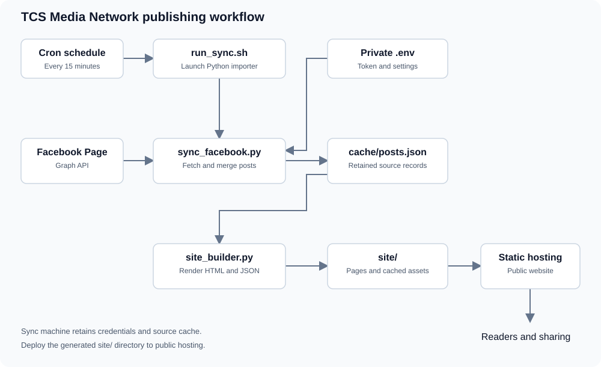

# TCS Facebook-to-Website Starter (No Database)

Create an automatic news website for The Comment Section Media Network. Each Facebook Page post becomes its own **static HTML article**. The website includes Latest News, #Trending, #BreakingNews, and topic sections from the post's hashtags. It uses **Python standard library only**; no WordPress, Smash Balloon, MySQL, or third-party Python dependencies.

## Background

The Comment Section Media Network publishes stories through its Facebook Page. This project gives those stories a browsable website with a dedicated article URL for each imported post, topic pages derived from hashtags, and a homepage that highlights featured and recent stories.

Editors continue publishing captions on Facebook. A scheduled Python job turns that content into HTML, ready for static hosting. The website serves generated files directly, keeping the publishing workflow small and the public hosting requirements simple.

## Architecture



The diagram shows the sync machine and the public website as separate stages. They can run on the same server when the host serves the generated `site/` directory directly. With a separate static hosting provider, deployment copies that directory to the host after a successful sync.

| Component | Responsibility |
| --- | --- |
| Cron | Starts the importer on a schedule |
| `run_sync.sh` | Changes into the project directory and launches Python |
| `.env` | Supplies private Facebook credentials and optional settings |
| `sync_facebook.py` | Reads Facebook posts, follows pagination, merges cached records, and downloads supported images |
| `cache/posts.json` | Retains imported records between sync runs |
| `site_builder.py` | Creates the homepage, listings, article pages, topic pages, and public JSON |
| `site/` | Holds the generated website and its assets |
| Static host | Serves the published files to readers |
| `app.js` and `theme.js` | Provide story filtering, mobile navigation, sharing, and theme controls in the browser |

## How publishing works

1. An editor publishes a Facebook Page post with a headline on the first content line, story text below it, and optional hashtags.
2. Cron runs `run_sync.sh`. The importer loads `.env`, with exported environment variables taking precedence.
3. The importer connects to the configured Page and requests published posts through Meta’s Graph API, including publication timestamps, captions, original links, and available images.
4. Imported posts are normalized and merged by Facebook post ID with the existing cache. Posts classified as “Photo or video update from TCS” are excluded from publication.
5. Supported Facebook images are cached under `site/assets/fb/`. The source cache is saved outside the public website directory.
6. The builder generates an article per post, topic pages from hashtags, and the homepage, Latest News, and Trending listings. It removes stale generated article and category pages that are absent from the current build input.
7. The web server serves the refreshed `site/` directory, or a separate deployment step uploads it to the hosting provider.
8. Readers browse generated pages and use the share icons to share an article’s hosted URL.

A regular sync fetches two API pages by default, with 50 posts requested per page. Use `--all` for a history backfill of up to 250 API pages. The number of posts actually returned depends on Facebook’s response.

## Content and presentation

The headline comes from the first content line of a caption. Article pages show its complete text above the story. Story text and card previews begin after that headline, preventing duplicate introductory text. Standard cards show short excerpts, while the Spotlight card allows up to 12 lines of story text.

Publication dates come from Facebook’s `created_time` and display in Philippine time, UTC+8. Missing or invalid timestamps display “Publication date unavailable”. The importer also retains `updated_time` for the source record.

Captions containing `Full Reel: https://...` display a clickable **Full Reel** label pointing to that URL. Article pages include icon buttons for WhatsApp, X, Messenger, Viber, and Telegram. Viber sharing requires a compatible installed app. Messenger setup is described below.

## Configuration reference

| Setting | Purpose | Default or requirement |
| --- | --- | --- |
| `FB_TOKEN` | Access token used by the Facebook importer | Required for live sync |
| `FB_PAGE_ID` | Selects the intended Facebook Page | Optional when Page identity is unambiguous |
| `FB_API_VERSION` | Graph API version used for requests | `v26.0` in the supplied example |
| `FB_PAGES` | Number of API pages fetched by a regular sync | `2` |
| `FB_APP_ID` | Public Meta App ID used by Messenger’s Send dialog | Optional |
| `UAT_MODE` | Shows the acceptance-testing banner and watermark | `true`, set `false` for final release |

Use `.env.example` as the starting point for local settings. Keep `.env` beside `run_sync.sh` and configure the host’s document root to serve `site/`.

## Operations and troubleshooting

Run `./run_sync.sh --check` to check Page identity and read one post before scheduling imports. A successful check verifies API access. Run `./run_sync.sh` to generate website output.

For a 15-minute schedule, add the following entry with the actual project path. The cron environment must make `python3` available on `PATH`.

```cron
*/15 * * * * /bin/sh /absolute/path/to/project/run_sync.sh >> /absolute/path/to/project/sync.log 2>&1
```

Schedule runs far enough apart for the previous sync to finish. The current importer uses a shared cache temporary file and writes generated pages directly, so overlapping sync jobs should be avoided.

| Symptom | Check or action |
| --- | --- |
| `FB_TOKEN is missing` | Set the token in `.env` on the machine running cron |
| Graph API error 190 | Replace the expired or invalid token |
| Permission or Page-selection error | Verify the token’s access to the intended Page and the `FB_PAGE_ID` setting |
| No published posts returned | Check Page selection and API permissions using `--check` |
| Hosted website appears stale | Confirm the sync succeeded and the resulting `site/` directory was deployed |
| Updated styles appear stale | Reload the page and confirm the updated CSS and HTML were deployed together |
| Images are missing after Git-based deployment | Include generated `site/assets/fb/` files in the deployment artifact |
| Older Facebook edits or deletions persist | A regular sync only refreshes fetched records and retains older cached records. Back up the cache before rebuilding history |

The cache is the retained content history between runs. Preserve it on the sync machine along with `.env`, and keep generated assets available when deploying article pages that reference them.


## Quick test on a Mac

In Terminal:

```bash
unzip TCS-Facebook-Auto-News-Website.zip
cd tcs-facebook-static

# You already exported FB_TOKEN in this Terminal session.
python3 sync_facebook.py

# In this Terminal window, start the local site:
python3 -m http.server 8000 --directory site
```

Open **http://localhost:8000** in your web browser.

> If you see `FB_TOKEN is missing`, run `export FB_TOKEN="YOUR_PAGE_ACCESS_TOKEN"` in that same Terminal first. Do not put the token into `index.html`, JavaScript, or `site/data/posts.json`.

Opening the website or running the HTTP server does **not** fetch Facebook posts. Run the sync first, then reload the browser. The working website contains the most recently generated pages. Use `--demo` to generate labeled sample stories.

Both `python3 sync_facebook.py` and `./run_sync.sh` automatically read the private `.env` file in this project. Exported environment variables take precedence. Values are literal (shell commands and variable expansion are not executed).

To diagnose access without changing the website:

```bash
python3 sync_facebook.py --check
```

This checks Page identity and reads one published post. A connection error means the sync could not reach Facebook; error 190 means the token needs replacing. Permission errors need to be resolved in the Meta app/token configuration. An empty post response leaves the existing website untouched and makes a normal sync fail instead of reporting a successful import.

If you have `FB_PAGE_ID`, you may optionally set it with `export FB_PAGE_ID="123456789"`. Otherwise the script uses `/me` with the Page token to detect the Page.

The importer also accepts a user access token: it reads `/me/accounts` and uses the returned Page access token. This requires `pages_show_list` and access to the intended Page, alongside permissions to read its posts such as `pages_read_engagement`. If multiple managed Pages are returned, set `FB_PAGE_ID` to choose one. Personal profile posts are not supported. A Page token must match `FB_PAGE_ID` when that setting is supplied.

### Import more than the latest 100 posts

```bash
python3 sync_facebook.py --all
```

Run `--all` once to backfill Page history (up to 250 API pages, using the Graph pagination cursor). Normal sync fetches the two most recent API pages and **merges** them into the local cache to keep older imported articles.

### Preview without a token

```bash
python3 sync_facebook.py --demo
python3 -m http.server 8000 --directory site
```

Demo articles are clearly labeled **DEMO CONTENT** and are replaced when you run a real sync. They are not news reports.

## Website structure

```text
tcs-facebook-static/
├── sync_facebook.py       # Meta Graph API client / sync job
├── site_builder.py        # Builds all HTML pages from posts
├── demo_posts.json        # Test content only
├── run_sync.sh            # Cron-ready wrapper (optional .env)
├── .env.example           # Sample private environment file
├── cache/posts.json       # Local source cache, outside the public site (generated)
└── site/                  # ONLY THIS FOLDER is public / uploaded to hosting
    ├── index.html         # Homepage with featured/latest/trending
    ├── latest.html        # All imported posts, newest first
    ├── trending.html      # Posts with #Trending hashtag
    ├── articles/          # ONE .html PER Facebook post
    ├── category/          # Pages created from hashtags
    ├── data/posts.json    # Public, sanitized JSON (no tokens)
    └── assets/            # TCS logo, banner, cached Facebook images
```

## Hashtag rules

- **Latest News**: ALL posts, most recent first. No hashtag needed.
- **Trending**: posts with `#Trending` in the caption, case-insensitive. It is **not** determined by likes/shares.
- **Breaking News**: posts with `#BreakingNews` (appears in the breaking banner and its category).
- **Spotlight**: the most recent `#Featured` post, otherwise the newest post.
- **Categories**: any other hashtag (e.g. `#Politics`, `#Sports`, `#Entertainment`, `#Community`). One post can belong to several categories.

Example Facebook caption:

```text
New policy announcement prompts discussion

Full details from the TCS newsroom...

#Politics #Trending #Featured
```

This generates a unique article in `site/articles/` that appears in Latest News, Politics, Trending, and the featured section.

## Automatic sync using cron (on a Linux host or macOS)

Cron does **not** inherit your interactive Terminal's `export FB_TOKEN` value. For unattended runs:

1. Copy `.env.example` to `.env` and replace the placeholder with your token.
2. Run `chmod 600 .env` (keep `.env` outside the public `site/` folder).
3. Verify `./run_sync.sh` works.
4. Add this to `crontab -e` with **your own absolute folder path**:

```cron
*/15 * * * * cd /absolute/path/tcs-facebook-static && ./run_sync.sh >> sync.log 2>&1
```

Every 15 minutes the script refreshes recent posts, merges with the cache, and rewrites the static HTML pages. **You must run the job on the hosting server** or separately deploy the updated `site/` output; running it on your laptop does not update a remote website automatically.

## Notes / limitations

- Requires a valid Meta Page Access Token with permission to read the Page's published posts.
- The importer tries to fetch text, date, permalink, thumbnail, and image attachments. Some Graph API fields or CDN images may not be available depending on permissions and post type; such posts still get article pages.
- The importer caches images locally when they are served from Meta's Facebook CDN. Other media (video/reels, album galleries) are represented by article links to the original post, not copied or downloaded.
- This simple starter preserves **previously imported** posts even if they fall outside the recent sync window. If an older Facebook post is edited/deleted, this starter does not automatically remove it. You can clear `cache/posts.json` and run `--all` to rebuild from currently available posts (after backing up your cache).
- Use the Page owner's permission to republish its content, in addition to API permission.
- There is no live automatic engagement ranking; `#Trending` is an editorial classification.
- The `site/` directory contains only public data and rendered HTML. Your `.env`, token, and source cache remain outside the web root.
- When ready to publish, upload the **contents of `site/`** to a static host or the document root of your web server.


## UAT preview and final release

UAT mode is enabled by default. Every generated page displays a gold **UAT PREVIEW** notice and a diagonal watermark. Readers can continue navigating, searching, and sharing during acceptance testing.

Keep the following setting in the private `.env` file during UAT.

```env
UAT_MODE='true'
```

After final approval and payment, set `UAT_MODE='false'` and rebuild the existing website.

```sh
./run_sync.sh --rebuild
```

This command reads existing `site/data/posts.json` and applies the current settings without fetching Facebook posts. Deploy the refreshed `site/` directory, then reload the hosted pages. Regular syncs also apply the setting. Exported environment variables take precedence over `.env` values.

The watermark is a visible evaluation notice. Someone with access to the source or hosting files can remove it. Control access to deployment credentials and the final handover separately.


## Messenger article sharing

To enable the Messenger Send dialog with the article link attached, configure your Meta App ID.

1. Open [Meta for Developers — My Apps](https://developers.facebook.com/apps/) and select your app.
2. Open **App settings → Basic** and copy the numeric **App ID**.
3. Add the following setting to the private `.env` file beside `run_sync.sh`, replacing the example value with your App ID.

```env
FB_APP_ID='123456789012345'
```

4. Run the sync to rebuild the article pages.

```sh
./run_sync.sh
```

5. Deploy the updated `site/` directory, reload an article, and test its Messenger icon.

The App ID is a public identifier included in generated pages. Keep the App Secret and Facebook access token in private server settings.

The Send dialog requires an app configuration that permits the hosted website URL and its redirect URL. Check your app’s website and domain settings and test on the deployed domain. Direct sending remains subject to Meta’s app configuration and dialog availability.

When `FB_APP_ID` is absent, the Messenger button opens messenger.com and copies the article link for the reader to paste into a conversation. If clipboard access is unavailable, it displays a selectable link to copy.
